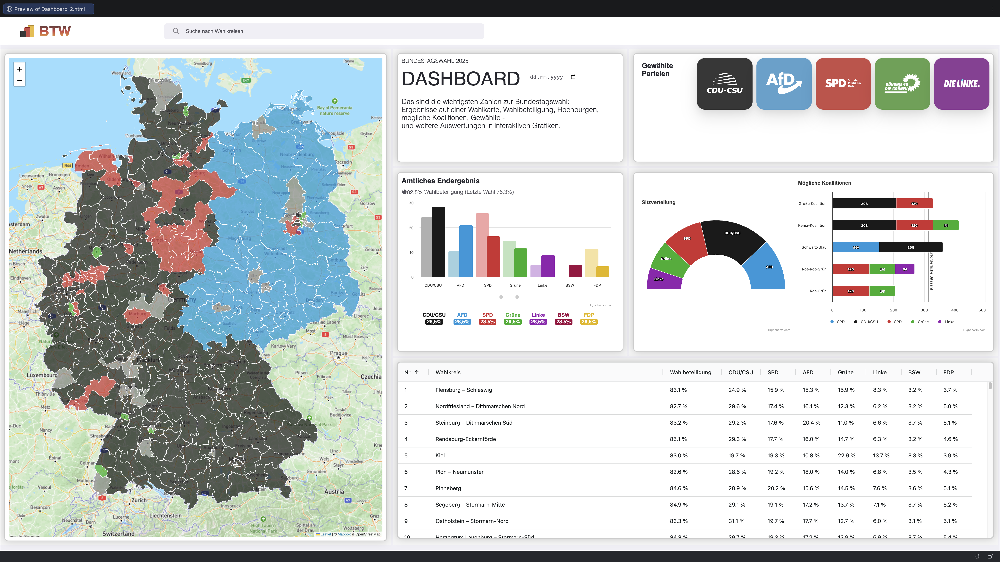

# 🗳️ Bundestagswahl 2025 – Interaktives Dashboard

Ein modernes, interaktives Web-Dashboard zur Visualisierung und Analyse der Ergebnisse der Deutschen Bundestagswahl 2025. Die Anwendung kombiniert geografische Daten mit interaktiven Diagrammen und einer durchsuchbaren Datentabelle, um Wahlergebnisse auf Bundes- und Wahlkreisebene übersichtlich darzustellen.



---

## ✨ Hauptfunktionen

* **🗺️ Interaktive Wahlkreiskarte (Leaflet & Mapbox):**
  * Farbliche Darstellung der stimmenstärksten Partei pro Wahlkreis auf Basis von GeoJSON-Daten (`wahlkreise.json`).
  * **Live-Tooltips:** Beim Überfahren eines Wahlkreises erscheint ein dynamisches Popup mit der Wahlbeteiligung sowie einem eingebetteten Balkendiagramm der Zweitstimmen-Verteilung.
* **🔍 Wahlkreis-Suche mit Auto-Complete:**
  * Über die Suchleiste in der Navigationsleiste können gezielt Wahlkreise (nach Name oder Nummer) gesucht werden.
  * Bei Auswahl zoomt die Karte automatisch auf den entsprechenden Wahlkreis, hebt ihn visuell hervor und öffnet die Detailansicht.
* **📊 Amtliches Endergebnis & Vergleich (Highcharts):**
  * Gegenüberstellung der Zweitstimmenanteile (2021 vs. 2025) für CDU/CSU, AfD, SPD, Grüne, Die Linke, BSW und FDP auf Basis von `deutschland.json`.
  * Anzeige der gesamten Wahlbeteiligung im Vergleich zur vorherigen Wahl.
* **🏛️ Sitzverteilung & Koalitionsrechner (Highcharts):**
  * **Sitzverteilung:** Halbkreis-Diagramm (Semi-Circle Donut) der im Bundestag vertretenen Fraktionen.
  * **Mögliche Koalitionen:** Gestapeltes Balkendiagramm zur Visualisierung potenzieller Regierungsbündnisse (z. B. Große Koalition, Kenia-Koalition, Schwarz-Blau, Rot-Rot-Grün, Rot-Grün) inklusive einer Markierungslinie für die erforderliche Mehrheit (315 Sitze).
* **📋 Sortierbare Wahlkreis-Tabelle (AG Grid):**
  * Tabellarische Übersicht aller Wahlkreise inklusive Wahlkreisnummer, Wahlbeteiligung und den prozentualen Zweitstimmenanteilen aller relevanten Parteien.

---

## 🛠️ Verwendete Technologien & Bibliotheken

* **Frontend:** HTML5, CSS3 (CSS Grid, Flexbox, Custom Properties / CSS-Variablen), Vanilla JavaScript (ES6+)
* **Karten & Geodaten:** [Leaflet.js](https://leafletjs.com/) (v1.9.4), [Mapbox GL / Tiles API](https://www.mapbox.com/), GeoJSON
* **Datenvisualisierung:** [Highcharts](https://www.highcharts.com/)
* **Datentabelle:** [AG Grid Community](https://www.ag-grid.com/) (v34.0.1)
* **Icons & Typografie:** Google Fonts (*Noto Sans*, *Roboto*) & *Material Icons / Symbols Sharp*

---

## 📁 Projektstruktur

```text
├── Dashboard_2.html        # Haupt-HTML-Datei (Layout & Einbindung der Bibliotheken)
├── dashboard-2.css         # Styling, CSS-Grid-Layout und Farbvariablen der Parteien
├── charts.js               # Logik für Highcharts (Endergebnis, Sitzverteilung, Koalitionen)
├── map.js                  # Leaflet-Karteninitialisierung, GeoJSON-Layer, Suche & Hover-Tooltips
├── table.js                # Konfiguration und Daten-Mapping für die AG Grid Tabelle
├── deutschland.json        # Aggregierte Wahldaten auf Bundesebene (2021 & 2025)
├── wahlkreise.json         # GeoJSON-Polygone und Wahldaten der einzelnen Wahlkreise
├── logo.svg                # Hauptlogo der Anwendung
└── images/
    └── logos/              # Parteilogos (Union, AfD, SPD, Grüne, Die Linke)
```

---

## 🚀 Installation & Lokale Ausführung

Da die Anwendung über die `fetch()`-API lokale JSON-Dateien (`deutschland.json` und `wahlkreise.json`) lädt, muss sie über einen lokalen Webserver (und nicht direkt per Doppelklick über `file://`) gestartet werden, um CORS-Blockaden zu vermeiden.

### Voraussetzungen
* Ein moderner Webbrowser (Chrome, Firefox, Edge, Safari)
* Ein lokaler Entwicklungsserver (z. B. VS Code *Live Server*, Python oder Node.js)
* Ein gültiger **Mapbox Access Token** (hinterlegt in `map.js`)

### Schritte zum Starten

1. **Repository klonen oder Dateien herunterladen:**
   ```bash
   git clone <dein-repository-url>
   cd <projekt-ordner>
   ```

2. **Mapbox-Token prüfen (optional):**
   Öffne die Datei `map.js` und stelle sicher, dass in Zeile 5 ein aktiver Mapbox API-Token hinterlegt ist:
   ```javascript
   const accessToken = 'DEIN_MAPBOX_ACCESS_TOKEN';
   ```

3. **Lokalen Server starten:**
   * **Mit VS Code:** Rechtsklick auf `Dashboard_2.html` $\rightarrow$ *"Open with Live Server"*.
   * **Mit Python 3:**
     ```bash
     python -m http.server 8000
     ```
     Anschließend im Browser `http://localhost:8000/Dashboard_2.html` aufrufen.

---

## 📝 Hinweise zu den Daten & Bekannte Punkte

* **Datenformat:** Die Anwendungen erwarten spezifische Property-Namen in den GeoJSON-Dateien (z. B. `Wahlkreis_Nr`, `Wahlbeteiligung_Percent_2025`, `CDU/CSU_Percent_2025`).
* **Sicherheitshinweis:** Für den produktiven Einsatz empfiehlt es sich, den öffentlichen Mapbox-Token im Mapbox-Dashboard über URL-Restrictions auf die eigene Domain zu beschränken.
